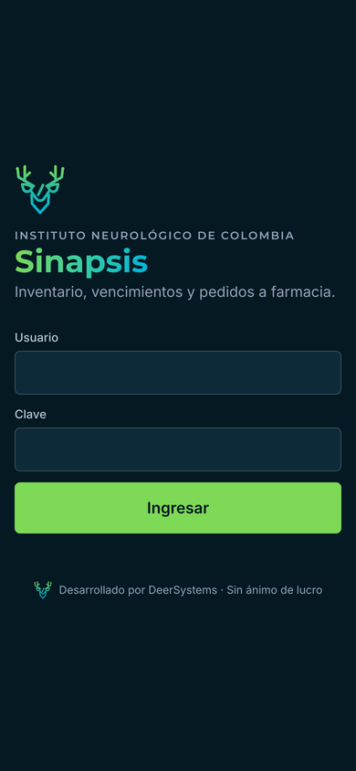
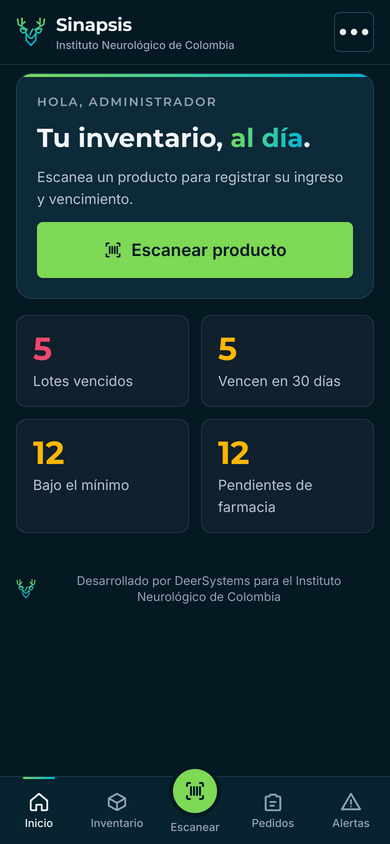
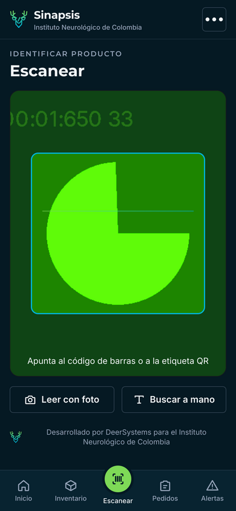
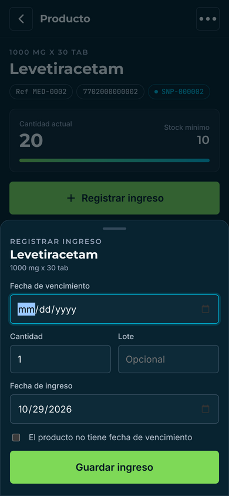
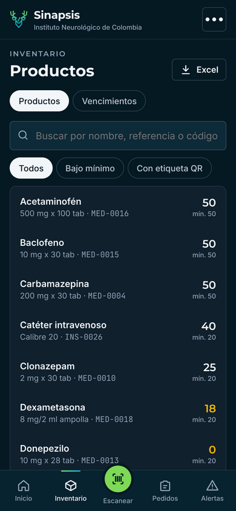
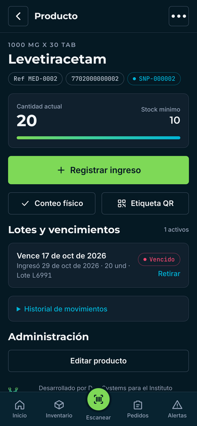
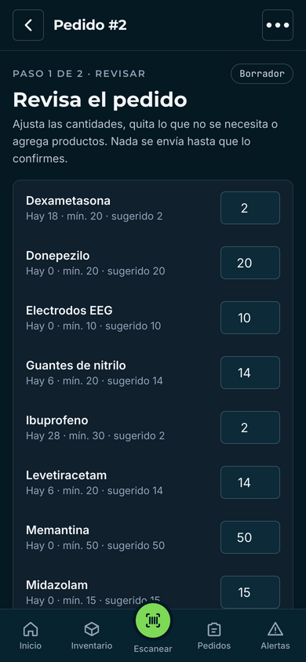
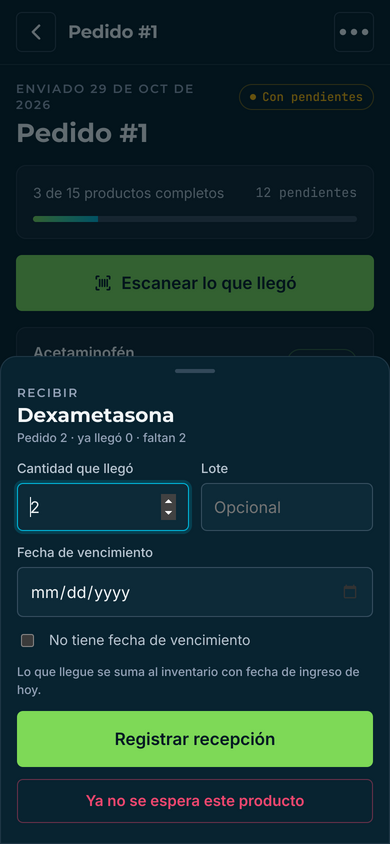
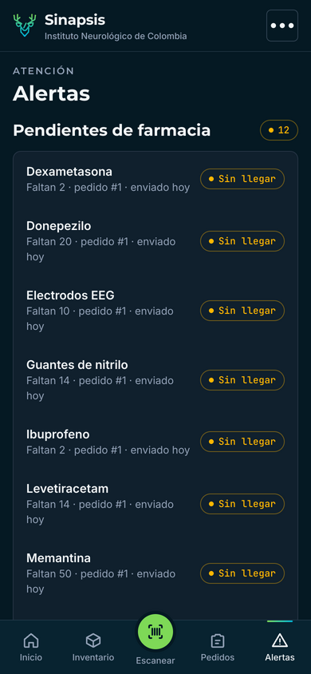

# Manual de usuario de Sinapsis

Sinapsis te ayuda a saber qué hay, qué está por vencer y qué falta pedir a farmacia, desde tu celular.

## 1. Instalar e ingresar
1. Abre en el navegador del celular la dirección que te dio el administrador.
2. Para tenerla como app: en Android, menú ⋮ → **Agregar a pantalla de inicio**; en iPhone, Safari →
   Compartir → **Agregar a inicio**.
3. Ingresa con tu usuario y clave. Cámbiala la primera vez en **⋯ → Cambiar clave**.

 

El **inicio** muestra cuatro cifras. Toca cualquiera para ver el detalle:
* **Lotes vencidos** (en coral): retíralos y regístralo en la app.
* **Vencen en 30 días** (en oro): úsalos primero.
* **Bajo el mínimo**: entrarán en el próximo pedido sugerido.
* **Pendientes de farmacia**: lo pedido que no ha llegado.

## 2. Registrar un ingreso
1. Toca el botón verde **Escanear** de la barra inferior y permite el uso de la cámara.
2. Apunta al **código de barras** o a la **etiqueta QR** del producto. Al leerlo, el celular vibra y abre el producto.
3. Si no tiene código: toca **Leer con foto** y toma una foto clara del nombre, de cerca y con buena luz.
   Elige el producto correcto de la lista. Cada vez que confirmas, Sinapsis aprende esa lectura.
4. Si tampoco funciona, toca **Buscar a mano** y escribe parte del nombre o la referencia.
   Se toleran errores de ortografía.
5. Llena la **fecha de vencimiento**, la **cantidad** y el **lote** (opcional). La fecha de ingreso
   ya viene con la de hoy. Toca **Guardar ingreso**.

 

> Si aparece el botón violeta **Probar con IA**, es el último recurso: úsalo solo cuando la foto
> normal no encuentre el producto. Si el producto se identificó con IA, imprime su etiqueta QR para
> que la próxima vez se lea al instante.

## 3. Consultar el inventario
En **Inventario** puedes buscar cualquier producto y filtrar los que están **bajo mínimo** o los que
usan **etiqueta QR**. La pestaña **Vencimientos** muestra los lotes vencidos, por vencer y vigentes.
El botón **Excel** descarga todo el inventario.

En la ficha de un producto ves su cantidad, el stock mínimo, sus lotes con vencimiento y el historial.
* **Conteo físico**: cuando cuentes el producto, escribe la cantidad real. Reemplaza la registrada y queda en el historial.
* **Retirar** un lote: cuando se vence, se daña o se acaba. Deja de generar alertas.
* **Etiqueta QR**: imprime la etiqueta del producto.

 

## 4. Hacer un pedido a farmacia
1. Después del inventario, ve a **Pedidos → Nuevo pedido sugerido**. Sinapsis arma la lista con todo
   lo que está por debajo del mínimo y la cantidad para volver a cubrirlo.
2. **Revisa cada línea**: cambia cantidades, pon 0 para quitar un producto, o toca **Agregar producto**.
   Nada se envía solo.
3. Haz el pedido a farmacia como siempre y guarda el **PDF del pedido final**.
4. En Sinapsis toca **Elegir PDF**, selecciona ese archivo y luego **Confirmar y marcar como enviado**.

## 5. Recibir el pedido
1. Cuando llegue la mercancía, abre el pedido en **Pedidos**.
2. Toca **Escanear lo que llegó** y escanea cada producto, o toca la línea en la lista.
3. Escribe la **cantidad que llegó** y su **fecha de vencimiento**. Toca **Registrar recepción**:
   se suma al inventario de inmediato.
4. Si llegó menos de lo pedido, la línea queda como **Parcial**.
5. Cuando termines, toca **Cerrar recepción**. Lo que no llegó queda como **pendiente** con alerta.
   Si llega días después, todavía puedes recibirlo en el mismo pedido.
6. Si un producto ya no se espera, toca su línea y **Ya no se espera este producto**.

 

## 6. Alertas
* **Sin llegar / Atrasado**: el producto se pidió y no ha llegado (atrasado: más de 5 días).
* **Posible desabastecimiento**: el producto no llegó en dos pedidos seguidos. Conviene preguntar a
  farmacia o buscar otra fuente.
* **Vencidos / Próximos a vencer / Bajo el mínimo**.

## 7. Para administradores
* **⋯ → Carga del catálogo**: plantilla de Excel y carga inicial ([guía](carga-inicial.md)).
* **⋯ → Etiquetas QR**: hoja lista para imprimir con las etiquetas de los productos sin código.
* **⋯ → Usuarios**: crear usuarios (operador o administrador) y desactivar a quien ya no trabaje.
* En la ficha de un producto: **Editar producto** y quitar alias mal aprendidos.

## Preguntas frecuentes
**La cámara no abre.** Revisa que el navegador tenga permiso de cámara para el sitio y que la dirección empiece por `https://`.

**La foto no encuentra el producto.** Acércate más, evita reflejos y que el nombre ocupe buena parte de la foto. Si sigue fallando, usa **Buscar a mano** y luego imprime su etiqueta QR.

**Me equivoqué en una cantidad.** Haz un **Conteo físico** con la cantidad correcta. El historial guarda los dos registros.

---
Sinapsis · Desarrollado por DeerSystems para el Instituto Neurológico de Colombia.
